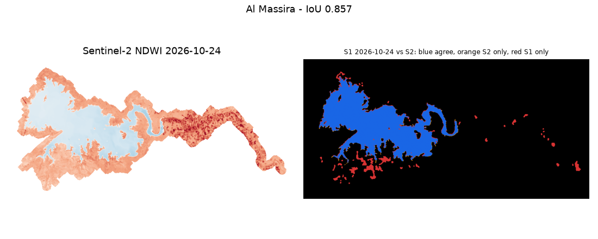
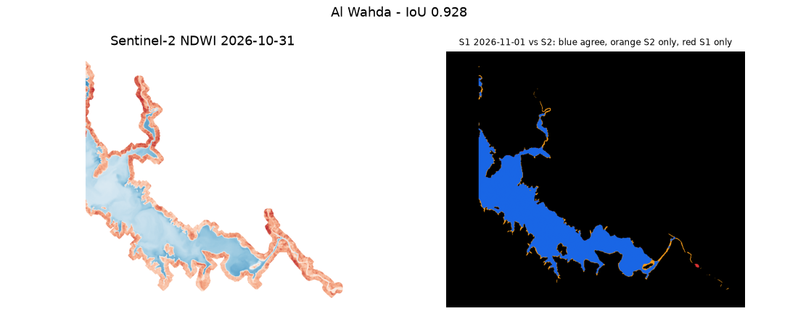
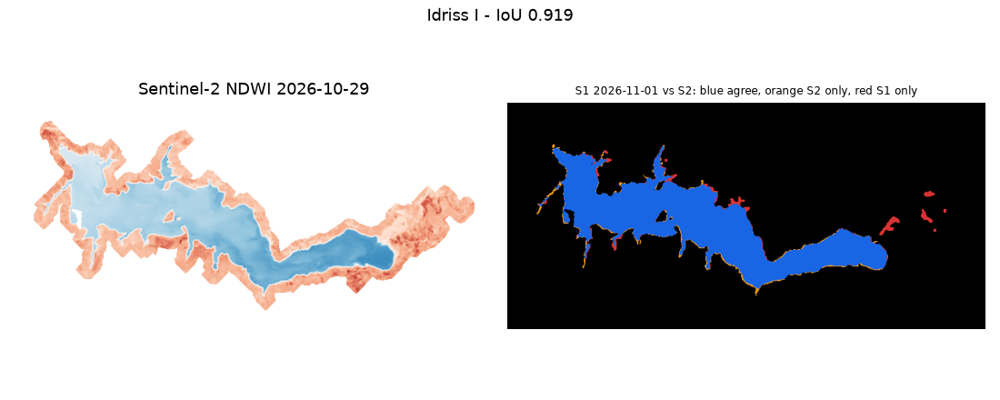
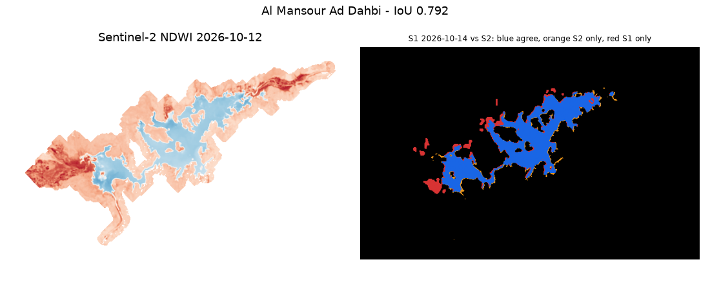
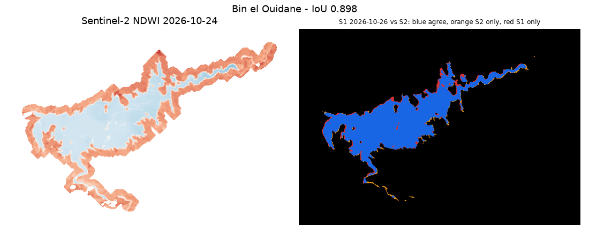
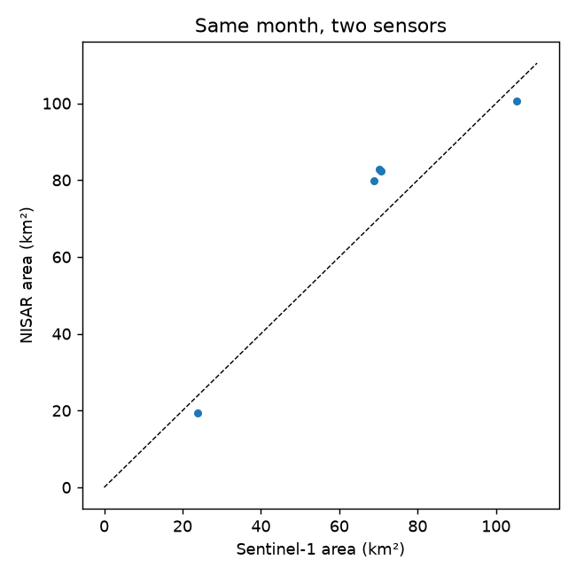

# Validation report

Generated by `pipeline/09_validate.py` on 2026-11-15 from the outputs in `data/processed/`.
Latest month in the data: **2026-10**. Re-run the step after each data drop.

## Summary

| Test | Reference | Metric | Target | Result |
|---|---|---|---|---|
| SAR area vs official storage | Al Maa Dialna fill rates | Pearson r | r >= 0.85 | Not run: no official fill rates in data/reference/official_fill.csv |
| Water mask accuracy | Sentinel-2 NDWI (clear days) | IoU, precision, recall | IoU >= 0.8 | PASS (mean IoU 0.882) |
| Sensor consistency | NISAR vs Sentinel-1, same month | mean abs. area difference | <= 10 % | BELOW TARGET (14.7 % over 5 months) |
| Temporal sanity | 2025 lows -> 2026 recovery | direction of change | rising | PASS (9/11 reservoirs up) |

## Headline numbers (for the pitch)

- National water area of the 9 monitored reservoirs with a 2015-2024 normal (of 11) in 2026-10: **357.57 km², 116.3 % of the 2015-2024 normal**.
- Lowest month since 2023-01: 2024-03 at 180.05 km² (54.5 % of normal); water area has changed by **+98.6 %** since.
- Status in 2026-10: 5 above normal, 2 normal, 2 no data, 1 drought, 1 watch.
- Radar water maps agree with cloud-free Sentinel-2 at a mean IoU of **0.882** (10 comparisons).

## 1. SAR area vs official storage

no official fill rates in data/reference/official_fill.csv. Add monthly values as `reservoir_id,month,official_fill_pct` (or `name,month,official_fill_pct`) and re-run steps 07-09.

## 2. Water mask accuracy (Sentinel-2 NDWI)

Sentinel-1 single-scene water mask (same algorithm as the monthly product) against Sentinel-2 L2A
NDWI > 0 (McFeeters, B03/B08) on scenes with < 5 % cloud, at most
3 days apart, inside the search zone and on clear pixels (SCL) only.

| reservoir_id | name | s1_date | s2_date | gap_days | iou | precision | recall | s1_km2 | s2_km2 |
|---|---|---|---|---|---|---|---|---|---|
| MAR_0001 | Al Massira | 2026-10-24 | 2026-10-24 | 0 | 0.857 | 0.872 | 0.98 | 77.73 | 69.17 |
| MAR_0001 | Al Massira | 2026-10-12 | 2026-10-12 | 0 | 0.867 | 0.886 | 0.976 | 76.1 | 69.14 |
| MAR_0002 | Al Wahda | 2026-11-01 | 2026-10-31 | 1 | 0.928 | 0.996 | 0.931 | 88.51 | 94.7 |
| MAR_0002 | Al Wahda | 2026-10-14 | 2026-10-14 | 0 | 0.886 | 0.914 | 0.967 | 102.81 | 97.17 |
| MAR_0003 | Idriss I | 2026-11-01 | 2026-10-29 | 3 | 0.919 | 0.956 | 0.96 | 46.85 | 46.68 |
| MAR_0003 | Idriss I | 2026-10-20 | 2026-10-21 | 1 | 0.935 | 0.992 | 0.942 | 45.03 | 47.45 |
| MAR_0004 | Al Mansour Ad Dahbi | 2026-10-14 | 2026-10-12 | 2 | 0.792 | 0.845 | 0.926 | 25.67 | 23.43 |
| MAR_0004 | Al Mansour Ad Dahbi | 2026-09-20 | 2026-09-22 | 2 | 0.838 | 0.931 | 0.894 | 20.41 | 21.26 |
| MAR_0008 | Bin el Ouidane | 2026-10-26 | 2026-10-24 | 2 | 0.898 | 0.932 | 0.961 | 31.71 | 30.73 |
| MAR_0008 | Bin el Ouidane | 2026-10-14 | 2026-10-12 | 2 | 0.904 | 0.936 | 0.964 | 31.9 | 30.97 |

## 3. Sensor consistency (NISAR vs Sentinel-1)

| reservoir_id | name | n | mean_diff_pct | mean_abs_diff_pct |
|---|---|---|---|---|
| MAR_0001 | Al Massira | 3 | 16.9 | 16.9 |
| MAR_0002 | Al Wahda | 1 | -4.4 | 4.4 |
| MAR_0004 | Al Mansour Ad Dahbi | 1 | -18.5 | 18.5 |

Step 07 removes the remaining bias by scaling NISAR onto the Sentinel-1 baseline
(`data/processed/harmonization.csv`).

## 4. Temporal sanity (2025 -> 2026)

Mean water area over the calendar months present in both years (01, 02, 03, 04, 05, 06, 07, 08, 09, 10).

| reservoir_id | name | area_2025 | area_2026 | change_pct |
|---|---|---|---|---|
| MAR_0001 | Al Massira | 21.98 | 62.46 | 184.2 |
| MAR_0002 | Al Wahda | 82.99 | 93.77 | 13.0 |
| MAR_0003 | Idriss I | 30.85 | 47.52 | 54.0 |
| MAR_0004 | Al Mansour Ad Dahbi | 22.74 | 20.66 | -9.2 |
| MAR_0005 | Sidi Mohammed Ben Abdallah | 22.43 | 36.37 | 62.1 |
| MAR_0006 | Mohamed V | 23.46 | 23.08 | -1.6 |
| MAR_0007 | Oued El Makhazine | 34.81 | 35.57 | 2.2 |
| MAR_0008 | Bin el Ouidane | 7.9 | 31.19 | 294.8 |
| MAR_0009 | M'Dez | 4.58 | 11.36 | 148.2 |
| MAR_0011 | Ahmed El Hansali | 8.91 | 19.59 | 119.8 |
| MAR_0021 | Ouljet Es Soltane | 8.38 | 12.81 | 52.8 |

