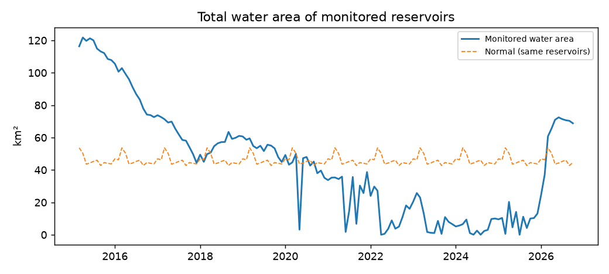

# Validation report

Generated by `pipeline/09_validate.py` on 2026-11-14 from the outputs in `data/processed/`.
Latest month in the data: **2026-10**. Re-run the step after each data drop.

## Summary

| Test | Reference | Metric | Target | Result |
|---|---|---|---|---|
| SAR area vs official storage | Al Maa Dialna fill rates | Pearson r | r >= 0.85 | Not run: no official fill rates in data/reference/official_fill.csv |
| Water mask accuracy | Sentinel-2 NDWI (clear days) | IoU, precision, recall | IoU >= 0.8 | PASS (mean IoU 0.862) |
| Sensor consistency | NISAR vs Sentinel-1, same month | mean abs. area difference | <= 10 % | BELOW TARGET (10.9 % over 1 months) |
| Temporal sanity | 2025 lows -> 2026 recovery | direction of change | rising | PASS (1/1 reservoirs up) |

## 1. SAR area vs official storage

no official fill rates in data/reference/official_fill.csv. Add monthly values as `reservoir_id,month,official_fill_pct` (or `name,month,official_fill_pct`) and re-run steps 07-09.

## 2. Water mask accuracy (Sentinel-2 NDWI)

Sentinel-1 single-scene water mask (same algorithm as the monthly product) against Sentinel-2 L2A
NDWI > 0 (McFeeters, B03/B08) on scenes with < 5 % cloud, at most
3 days apart, inside the search zone and on clear pixels (SCL) only.

| reservoir_id | name | s1_date | s2_date | gap_days | iou | precision | recall | s1_km2 | s2_km2 |
|---|---|---|---|---|---|---|---|---|---|
| MAR_0001 | Al Massira | 2026-10-24 | 2026-10-24 | 0 | 0.857 | 0.872 | 0.98 | 77.73 | 69.17 |
| MAR_0001 | Al Massira | 2026-10-12 | 2026-10-12 | 0 | 0.867 | 0.886 | 0.976 | 76.1 | 69.14 |

## 3. Sensor consistency (NISAR vs Sentinel-1)

| reservoir_id | name | n | mean_diff_pct | mean_abs_diff_pct |
|---|---|---|---|---|
| MAR_0001 | Al Massira | 1 | 10.9 | 10.9 |

Step 07 removes the remaining bias by scaling NISAR onto the Sentinel-1 baseline
(`data/processed/harmonization.csv`).

## 4. Temporal sanity (2025 -> 2026)

Mean water area over the calendar months present in both years (01, 02, 03, 04, 05, 06, 07, 08, 09, 10).

| reservoir_id | name | area_2025 | area_2026 | change_pct |
|---|---|---|---|---|
| MAR_0001 | Al Massira | 8.47 | 61.24 | 622.7 |

